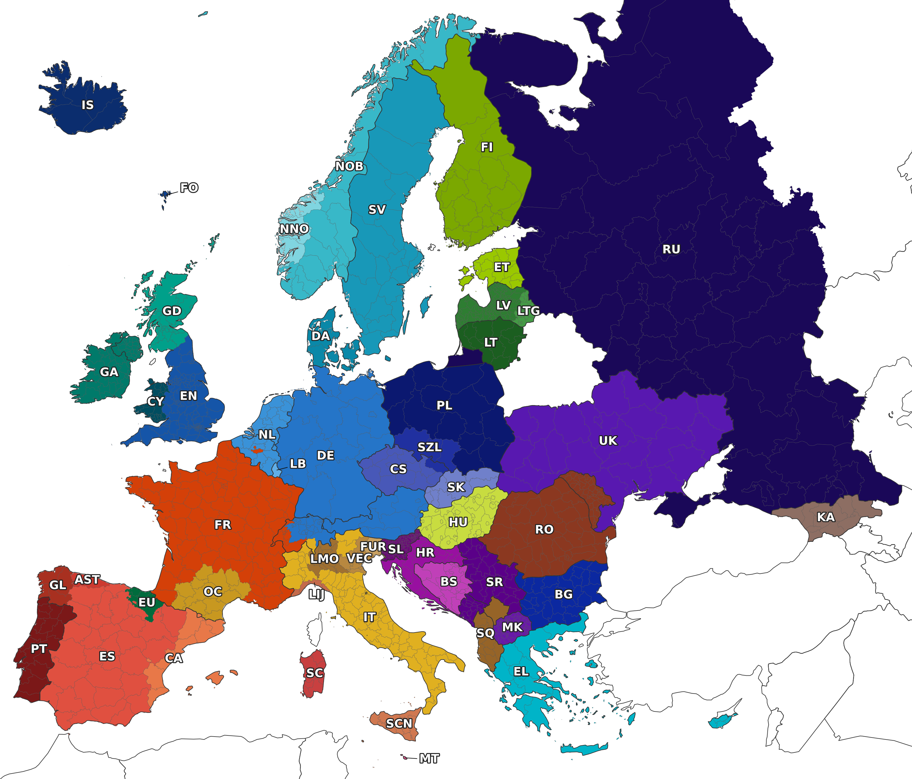

# European IFEval

European IFEval is a 50-language benchmark for evaluating whether language
models follow verifiable instructions. This repository contains the normalized
benchmark data, the evaluator and an optional self-contained Hugging Face
generation example.

The benchmark construction and evaluation methodology are described in
[*EuroAlpaca: Task-Preserving Localisation of Instruction Data for European
Languages*](https://arxiv.org/pdf/2609.05043).

The core workflow is independent of any model or inference framework:

```text
Model or external inference system
              |
              v
{"prompt": "...", "response": "..."} JSONL
              |
              v
European IFEval evaluator
              |
              v
Strict and loose accuracy scores
```

## Repository contents

- `assets/`: figures used in the documentation.
- `data/`: 50 normalized JSONL test sets and `source.json` provenance metadata.
- `evaluation/`: instruction-following evaluator and unit tests.
- `examples/`: a minimal valid input/response pair for a smoke test.
- `scripts/1_generate_responses.py`: optional off-the-shelf Hugging Face example.
- `scripts/2_evaluate_generated_responses.sh`: convenience batch evaluator.
- `prompt_templates/`: multilingual Alpaca-style prompt templates used by the example generator.

`data/source.json` is the per-language manifest recording the selected upstream
source, provenance category, missing source items and explicit
response-language constraints for each IFEval dataset.

## Install the evaluator

Python 3.10 is recommended. With pyenv:

```bash
git clone https://github.com/Telefonica-Scientific-Research/european-ifeval.git
cd european-ifeval

pyenv install -s 3.10.0
pyenv local 3.10.0

python -m venv venv-european-ifeval
source venv-european-ifeval/bin/activate

python -m pip install --upgrade pip setuptools wheel
python -m pip install -r requirements.txt
python -m nltk.downloader punkt punkt_tab
```

## Prediction file format

The evaluator accepts JSON Lines with one object per benchmark prompt:

```json
{"prompt": "The exact prompt from the input dataset", "response": "The model response"}
```

The `prompt` must exactly match its value in the input dataset. A complete
evaluation requires exactly one response for every input prompt. Response order
does not matter because the evaluator joins records by the prompt string.

Your inference system may use any framework, API, hosted model or local model
as long as it produces this format.

## Evaluator smoke test

The included example does not contain a language-detection rule, so it does not
need the GlotLID model:

```bash
mkdir -p /tmp/european-ifeval-smoke

python -m evaluation.evaluation_main \
  --input_data=examples/input.example.jsonl \
  --input_response_data=examples/responses.example.jsonl \
  --output_dir=/tmp/european-ifeval-smoke
```

The strict and loose prompt-level scores should both be `1.000`.

## Evaluate model responses

For example, to evaluate German responses:

```bash
mkdir -p outputs/results/de/my-model/my-experiment

python -m evaluation.evaluation_main \
  --input_data=data/de.jsonl \
  --input_response_data=/path/to/de-responses.jsonl \
  --output_dir=outputs/results/de/my-model/my-experiment \
  --glotlid_min_confidence=0.5
```

The output directory contains:

- `eval_results_strict.jsonl`
- `eval_results_loose.jsonl`
- `language_detection_failures_strict.jsonl`
- `language_detection_failures_loose.jsonl`

The command also prints strict and loose aggregate scores.

### GlotLID

Language constraints are evaluated with
[GlotLID](https://huggingface.co/cis-lmu/glotlid). When a language rule is
encountered, the evaluator loads `cis-lmu/glotlid` through the Hugging Face
cache/download mechanism.

To use a local copy instead:

```bash
export GLOTLID_MODEL_PATH=/path/to/glotlid/model.bin
```

## Optional Hugging Face generation example

Generation is optional and has a separate, much larger dependency set. The
provided example supports ordinary off-the-shelf causal language models.

Install generation dependencies:

```bash
python -m pip install -r requirements-generation.txt
```

Check the command without loading a model:

```bash
python scripts/1_generate_responses.py --help
```

Generate the full German response file:

```bash
python scripts/1_generate_responses.py \
  --model CohereLabs/tiny-aya-global \
  --language de \
  --model-type it
```

The default output is:

```text
outputs/generated_responses/de/tiny-aya-global/off-the-shelf.jsonl
```

For a quick generation smoke test, use `--limit`. A partial response file is
useful for checking model loading but cannot be evaluated against the complete
benchmark dataset:

```bash
python scripts/1_generate_responses.py \
  --model CohereLabs/tiny-aya-global \
  --language de \
  --model-type it \
  --limit 2 \
  --output /tmp/de-responses-smoke.jsonl
```

Generation uses deterministic greedy decoding. Note that `CohereLabs/tiny-aya-global`
requires a Hugging Face account, acceptance of its access conditions and
adherence to its non-commercial license and acceptable-use policy. Pass
`--trust-remote-code` only for model repositories you trust.

## Evaluate generated files by convention

If responses use the default generator directory structure, the convenience
script can evaluate one or more languages:

```bash
LANGS="ca de es" \
MODEL_NAME="tiny-aya-global" \
EXP_NAME="off-the-shelf" \
scripts/2_evaluate_generated_responses.sh
```

Results are written under:

```text
outputs/results/{language}/{model}/{experiment}/
```

## Languages



*Approximate traditional geographic areas associated with the languages and
regional varieties covered by EuroAlpaca and European IFEval. Boundaries are
schematic and do not represent exclusive or current speaker distributions.*


| Dataset code | Language |
|---|---|
| `ast` | Asturian |
| `bg` | Bulgarian |
| `bs` | Bosnian |
| `ca` | Catalan |
| `cs` | Czech |
| `cy` | Welsh |
| `da` | Danish |
| `de` | German |
| `el` | Greek |
| `es` | Spanish |
| `et` | Estonian |
| `eu` | Basque |
| `fi` | Finnish |
| `fo` | Faroese |
| `fr` | French |
| `fur` | Friulian |
| `ga` | Irish |
| `gd` | Scottish Gaelic |
| `gl` | Galician |
| `hr` | Croatian |
| `hu` | Hungarian |
| `is` | Icelandic |
| `it` | Italian |
| `ka` | Georgian |
| `lb` | Luxembourgish |
| `lij` | Ligurian |
| `lmo` | Lombard |
| `lt` | Lithuanian |
| `ltg` | Latgalian |
| `lv` | Latvian |
| `mk` | Macedonian |
| `mt` | Maltese |
| `nl` | Dutch |
| `nn` | Norwegian Nynorsk |
| `no` | Norwegian Bokmål |
| `oc` | Occitan |
| `pl` | Polish |
| `pt` | Portuguese |
| `ro` | Romanian |
| `ru` | Russian |
| `sc` | Sardinian |
| `scn` | Sicilian |
| `sk` | Slovak |
| `sl` | Slovenian |
| `sq` | Albanian |
| `sr` | Serbian |
| `sv` | Swedish |
| `szl` | Silesian |
| `uk` | Ukrainian |
| `vec` | Venetian |


The map uses `NOB` and `NNO` for Norwegian Bokmål and Norwegian Nynorsk, while
the repository uses `no` and `nn`, respectively. `EN` marks the English source
language discussed in the paper.

The [original IFEval benchmark](https://github.com/google-research/google-research/tree/master/instruction_following_eval) (in English)
contains 541 prompts. All native-speaker and verified-localized datasets in
this repository retain the complete set. Some machine-translated and localized
datasets contain 522–524 prompts because their upstream sources omit 17–19
samples. These known omissions are documented for each language in
`data/source.json` using the `missing_samples` and `ids_missing_samples` fields.

Evaluation is performed over the prompts present in the selected language
file. Consequently, results for languages with different prompt counts are not
based on perfectly identical evaluation sets. See `data/source.json` for each
dataset's source, quality, coverage and source-language constraint metadata.

## License

The European IFEval source code is licensed under the [Apache License
2.0](LICENSE). Third-party software attributions are recorded in
[NOTICE](NOTICE). The benchmark datasets retain their upstream terms and are
not covered by the code license. See [Dataset licensing and
attribution](DATA_LICENSES.md) for the per-source licenses and attribution.
